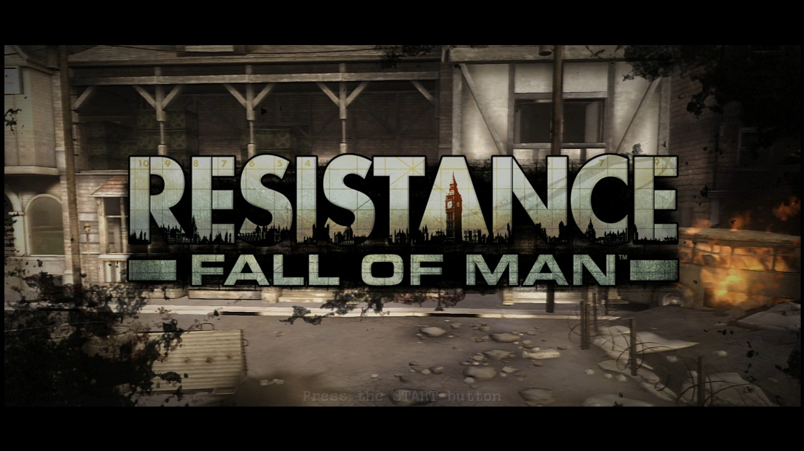
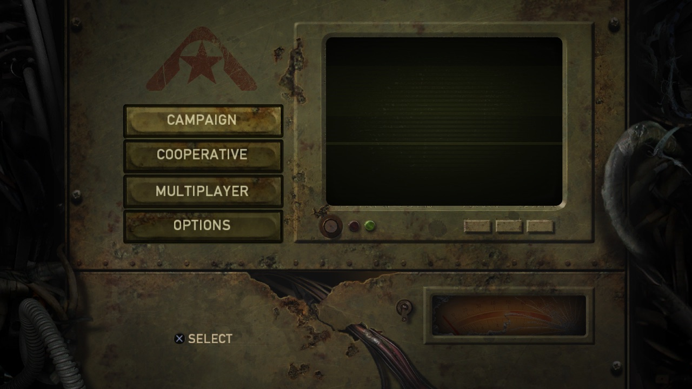
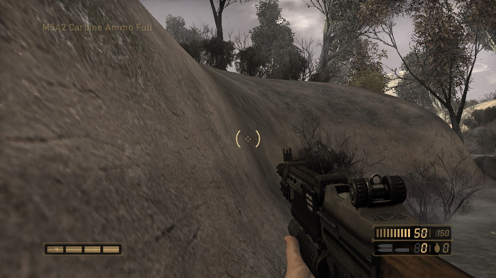
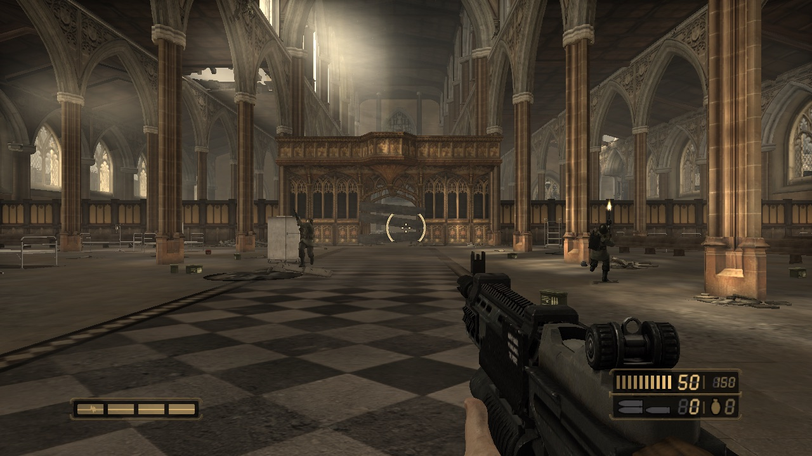
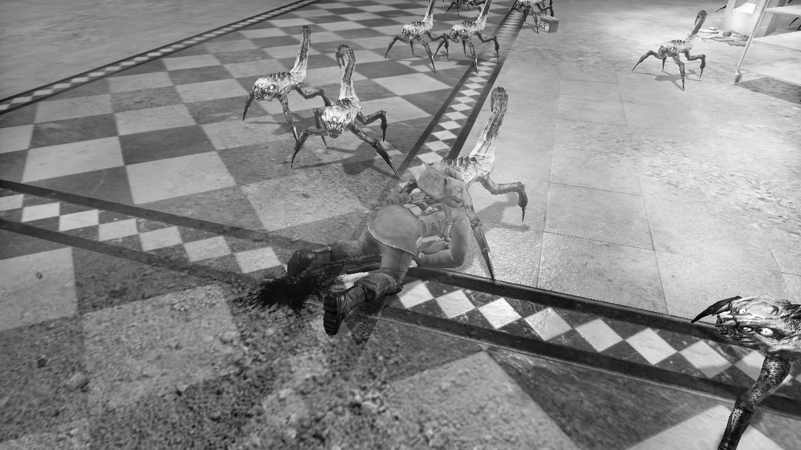
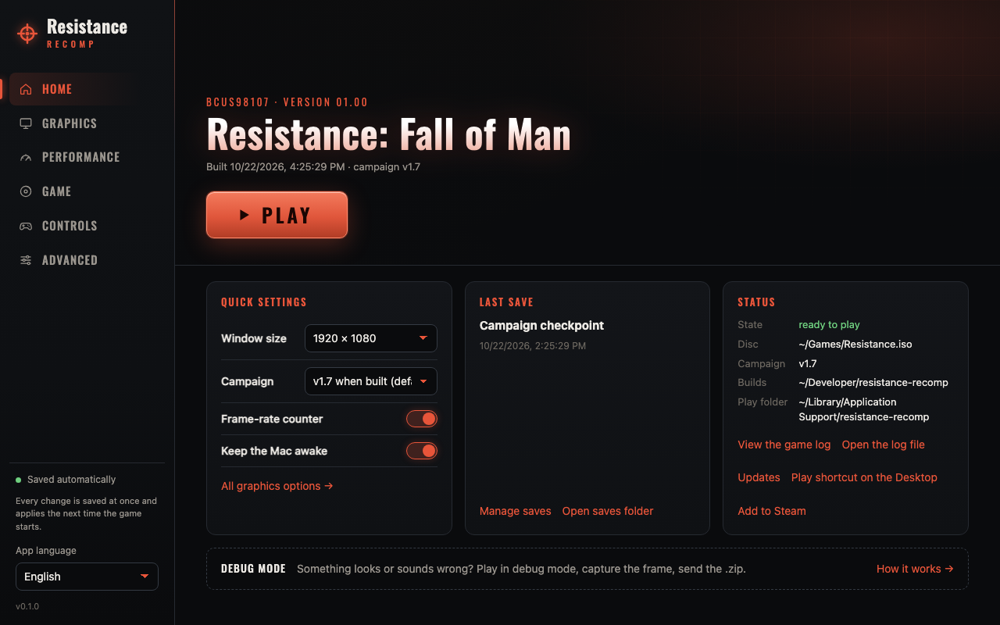
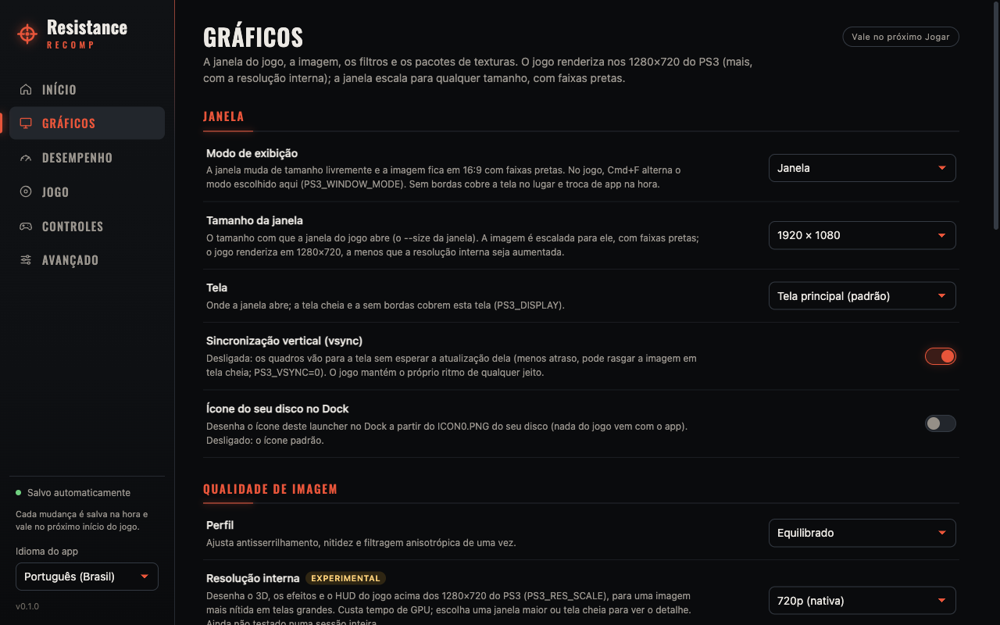

# Resistance: Fall of Man — static recompilation for PC (macOS)

🌐 **English** · [Português (BR)](README.pt-BR.md)

A native port of **Resistance: Fall of Man** (PS3, disc `BCUS98107`) to
**macOS/arm64**, built with static recompilation: the game's PowerPC and SPU
code is translated to C/C++ and compiled into native executables, with
graphics on Metal. It is not an emulator.

**It is playable.** The campaign has been played with a controller from York
through Grimsby and Manchester into Nottingham ("Viper's Nest"), at about
30 fps, the game's own target, and every one of its 30 levels loads to
gameplay.
Get the app from the
[releases page](https://github.com/erikomis/resistance-recomp/releases): you
pick your disc image and it builds the game from it ([how](#download-and-play)).

| | |
| --- | --- |
| [](docs/screenshots/01-title-screen.jpg)<br>Title screen | [](docs/screenshots/02-main-menu.jpg)<br>Main menu |
| [](docs/screenshots/03-york-river.jpg)<br>York: "A Lone Survivor" | [](docs/screenshots/04-manchester-cathedral.jpg)<br>Manchester: "The Cathedral" |
| [](docs/screenshots/05-cathedral-leapers.jpg)<br>Leapers in the cathedral | |

<sub>Frames from the port itself running on an Apple-silicon Mac, built from
the player's own disc, at the game's 1280×720. Resistance: Fall of Man ©
Sony Interactive Entertainment, developed by Insomniac Games; shown only to
document the port.</sub>

Built on [ps3recomp](https://github.com/sp00nznet/ps3recomp), following the
author's [inFAMOUS 2 port](https://github.com/erikomis/infamous2-recomp). See
[CREDITS.md](CREDITS.md).

> [!WARNING]
> **Alpha, not played to the end yet.** The campaign has been played into
> Nottingham; past that (Cheshire onwards), the levels load but nobody has
> played them by hand.
> Apple-silicon macOS only. A controller is the tested way to play. What is
> missing is in [ROADMAP.md](ROADMAP.md).

> **This repository contains no game data, no firmware, no Sony keys and
> nothing translated from them.** Everyone generates all of that locally from
> their own legitimate copy. The decryption keys are downloaded at build time
> from RPCS3's public source code, only to decrypt your own disc. A fan
> project, not affiliated with Sony Interactive Entertainment or Insomniac
> Games.

## Status

| | |
| --- | --- |
| Boot, legal screens, first-run install, title screen, menus | ✅ |
| Campaign: York, Grimsby, Manchester and Nottingham, played with a DualSense | ✅ first person, HUD, enemies, dying and respawning, Save & Quit and Continue (into "Viper's Nest", 2026-11-10) |
| The rest of the campaign (Cheshire to the Chimeran Tower) | 🧪 every level loads to gameplay with no errors; not played by hand yet |
| Performance | ✅ about 30 fps in play, the game's target; ⚠️ one heavy scene in "Outgunned" drops to 13–15 fps (being worked on); 🧪 an optional 60 fps patch (~88 fps in York; the three heaviest levels hold 30 but not 60) |
| Movies, music and sound (AC3 5.1, mixed to your output) | ✅ |
| Graphics | ✅ the world's colours, shadows, fog, water and the grass layer; ⚠️ dark speckles in some trees still to re-check |
| One window from the menus through the campaign | ✅ closing it ends the game at once |
| Controller (DualSense, DualShock 4; Xbox One/Series through SDL), rumble | ✅ DualSense; 🧪 Xbox and rumble not yet tried with a physical pad |
| Keyboard and mouse (remappable) | 🧪 mapped, not play-tested |
| In-game menu (F1 / Cmd+, / L3+R3): image, audio, controls, performance HUD, Quit game | 🧪 new in v0.3.0, checked headless through the menus and into gameplay; waiting for a windowed session |
| Offline split-screen (co-op and versus) | ✅ |
| Saves, Continue from a checkpoint | ✅ |
| Game update v1.7 for the campaign | ✅ when you have the update's files; the menus stay 01.00 |
| The app: one-click install from your disc, rebuild, play, settings, saves | ✅ |
| Online multiplayer | ❌ out of scope (the official servers are gone) |
| Linux and Windows | ⏳ not supported (a Windows launcher preview exists; the game itself builds only on macOS) |

The full table, with what each fix was, is in
[docs/TECHNICAL.md](docs/TECHNICAL.md#status). Next steps in
[ROADMAP.md](ROADMAP.md).

## Download and play

You need an Apple-silicon Mac, your own **Resistance: Fall of Man** disc
(`BCUS98107`, US) dumped to an `.iso` image, an internet connection the first
time and about 4 GB free.

1. Download the `.dmg` from the
   [releases page](https://github.com/erikomis/resistance-recomp/releases)
   (every release so far is a pre-release) and drag the app to Applications.
   It is not notarized: the first time, right-click > Open (or System Settings
   > Privacy & Security > Open Anyway).
2. Open it and press **Install the game**, then choose your `.iso`. If your
   Mac does not have Apple's Command Line Tools yet, macOS asks to install
   them (one click); the app waits and goes on by itself.
3. The app does the rest on its own, with one progress bar: it downloads the
   port's sources, the build tools (no Homebrew) and the decryption keys,
   decrypts your disc's two executables and builds the game. About 7 minutes
   on a recent Mac, up to 30 on a slower one. If something fails it says why
   in plain words, and pressing the button again continues where it stopped.
4. Press **Play**. On the very first boot press START twice: the legal
   screen, then the game's one-time "initial setup" install.

The release ships no game files: the app builds the game on your Mac from
your disc. The campaign runs the disc's 01.00 unless you also have the game's
v1.7 update files ([how](docs/TECHNICAL.md#the-v17-campaign)).

## The app

[`launcher/`](launcher/README.md) is a desktop app (Tauri) that does all of
this without a terminal: Home (your disc's art, PLAY, quick settings, last
save, status), Graphics, Performance, Game, Controls and Advanced.

- **Install the game** with one button, and **rebuild** after an update.
- **Updates itself** (from v0.3.0): the Updates card on Home offers
  **Download and install**, then **Restart to finish** (signed and checked),
  and afterwards **Rebuild the game**. v0.2.2 and older have no updater:
  install v0.3.0 by hand once.
- **Graphics:** window, fullscreen or borderless, vsync, filters (FXAA,
  SMAA, sharpening), MetalFX, texture packs, the 60 fps and field-of-view
  options.
- **Controls:** remap keyboard, mouse and controller, rumble; **audio**
  volume, mute and output device.
- **Saves:** list, back up, restore, import/export, `.zip`.
- **Debug mode:** play normally while the game logs what goes wrong;
  **Capture this frame**, then **Analyse** and **Create .zip** for a report.
  Plus a game log viewer.
- **Play shortcut** on the Desktop and **Add to Steam** (Big Picture with
  the controller).

**In the game,** F1 (fn+F1), Insert, Cmd+, or L3+R3 opens the **in-game
menu** (from the inFAMOUS 2 port): image (gamma, sharpening, FXAA/SMAA,
vibrance, contrast, vignette, film grain, MetalFX, vsync, display mode,
internal resolution), audio volume, controls (live remapping of keyboard,
mouse and controller, vibration, mouse), a performance HUD (fps, frame time,
CPU and GPU) and **Quit game**, which never ends the game in the middle of a
save. What you change is kept for the next start. Details in
[docs/TECHNICAL.md](docs/TECHNICAL.md#in-game-menu).

| | |
| --- | --- |
| [](launcher/docs/screenshots/home.en.png) | [](launcher/docs/screenshots/graphics.png) |

## Known problems

- **Frame drops in "Outgunned"** (Manchester): one big outdoor fight with
  about 2,500 draws a frame runs at 13–15 fps for a few seconds at a time
  (a quarter of the level below 17 fps in a play session). It is the CPU
  preparing the draws, not the GPU: a lower internal resolution only gains
  about 10%. The Resistance 2 port's draw-engine speed-ups are being brought
  over for it.
- **Grass disappearing or flickering** in some places: reported in play,
  being looked into (alpha-to-coverage, stale vertices and late SPU culling
  jobs were checked and ruled out).
- **Heavy levels:** "The Cathedral", "No Way Out" and "Ice and Iron" are the
  slowest: they hold 30 fps in play but not 60 with the 60 fps option. The
  limit is the game's SPU jobs, which it runs on one SPU.
- **Dark speckles** in some trees: the grass layer was fixed on 2026-11-06;
  the trees are still to re-check.
- **The menus stay 01.00:** only the campaign runs the v1.7 update (the
  update's menu executable exists only in a digital-edition form).
- **Keyboard and mouse, rumble, an Xbox pad:** implemented, not play-tested.
- **Online multiplayer** does not work (the servers are gone); offline
  split-screen does.

## Work in progress

What is being worked on now (details in [ROADMAP.md](ROADMAP.md)):

- **Playing the whole campaign:** played into Nottingham ("Viper's Nest");
  next is Cheshire.
- **Speed in the heavy scenes:** the Resistance 2 port's draw-engine work
  (vertex reuse within a frame, per-attribute fetches, GPU copies, larger
  caches, a background shader cache), measured on "Outgunned".
- **The grass** that disappears or flickers.
- **The snow lighting** in "Ice and Iron".
- **Pull requests to [ps3recomp](https://github.com/sp00nznet/ps3recomp)**
  for the toolkit fixes made here.

## Building from source

The app does all of this for you. To do it by hand you need the Xcode
Command Line Tools (`xcode-select --install`) and your disc mounted:

```sh
git clone https://github.com/erikomis/resistance-recomp.git
cd resistance-recomp
PS3_VFS_ROOT=/Volumes/<your disc> tools/install.sh
tools/play.sh
```

`tools/install.sh` puts the build tools in `~/Library/Application
Support/resistance-recomp/deps` (no Homebrew), sets up the toolkit, decrypts,
lifts and builds; run it again and it continues where it stopped. Every step,
the v1.7 campaign and the environment variables are in
[docs/TECHNICAL.md](docs/TECHNICAL.md#building-from-source).

## Fixes made here

The toolkit changes are in
[`patches/ps3recomp-a6d76c8-resistance.patch`](patches/ps3recomp-a6d76c8-resistance.patch),
applied by `tools/setup_toolkit.sh`. The ones that got the game going:

- **Gameplay at all:** the WWS job manager's policy module and SPURS
  scheduling, raw SPUs, per-thread callback stacks (the post-intro hang).
- **The blue world:** the RSX's 28-bit vertex-offset wrap.
- **Respawning in the sky:** a raw-SPU stop the runtime dropped.
- **Continue froze:** a raw-SPU parameter area that changes per checkpoint.
- **Grimsby froze, Location Select quit the game:** the system cache path,
  and Lua's `setjmp`/`longjmp` (a new lifter option).
- **Silent movies:** AC3 5.1 through FFmpeg.
- **Fog, water, shadows, split-screen, the grass layer:** the window origin,
  depth compares, surface eviction, scissored clears, the alpha test.
- **From other ports:** fixes from the
  [inFAMOUS 2 port](https://github.com/erikomis/infamous2-recomp), the
  Resistance 2 port and Psyykosis's
  [Windows port of this game](https://github.com/Psyykosis/Resistance-Fall-of-Man-Recomp)
  (credits in [CREDITS.md](CREDITS.md)).
- **Given back upstream:** pull requests to ps3recomp (scissored clears, the
  polygon offset, invariant positions, `cellSysconf`, the pad sensor mode and
  more; see [ROADMAP.md](ROADMAP.md#giving-back)).

## Layout

| Path | What it is |
| --- | --- |
| [`port/`](port/) | The game-specific code: boot, exitspawn, the optional game patches, SPU registration |
| [`patches/`](patches/) | The toolkit patch |
| [`tools/`](tools/) | Install, rebuild, decrypt, play and capture scripts |
| [`launcher/`](launcher/) | The app |
| [`docs/`](docs/) | Technical notes and screenshots |

## License

The port's own code is MIT ([LICENSE](LICENSE)); ps3recomp keeps its own
licence. Resistance: Fall of Man belongs to Sony Interactive Entertainment;
no part of the game is included.
