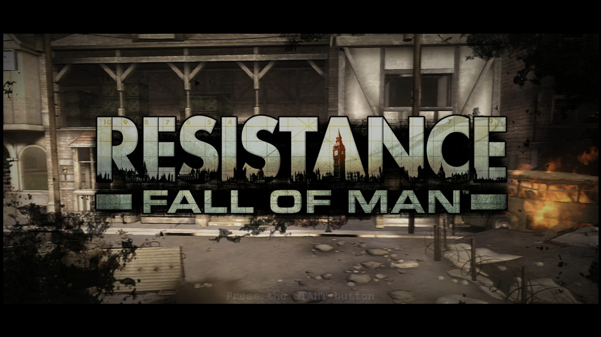
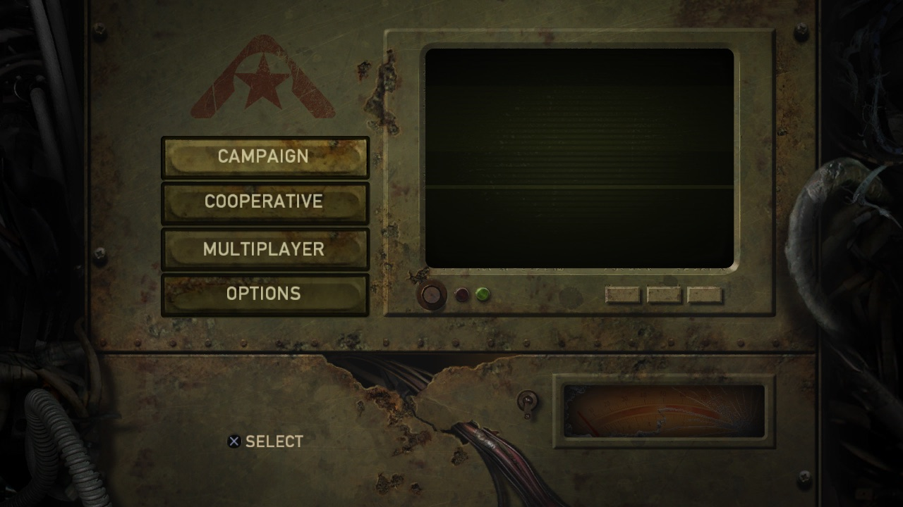
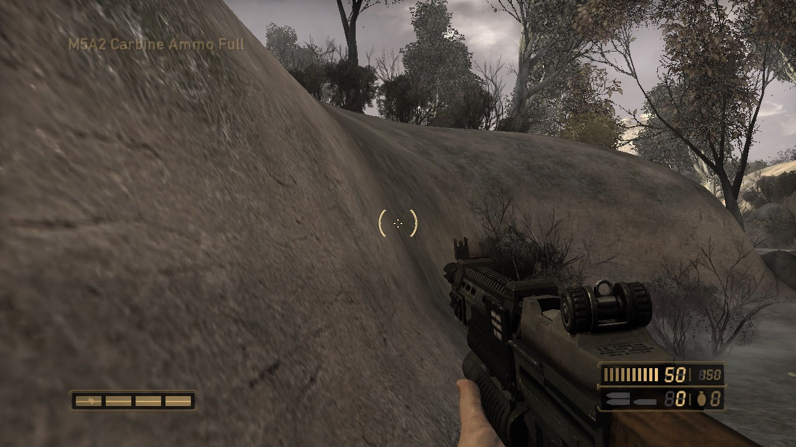
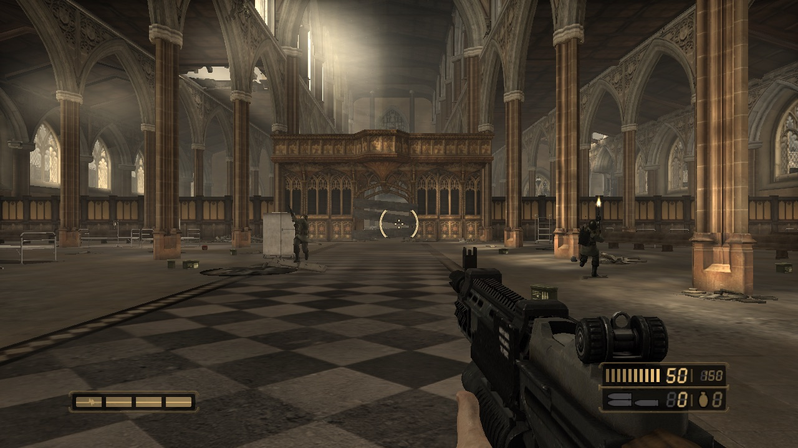
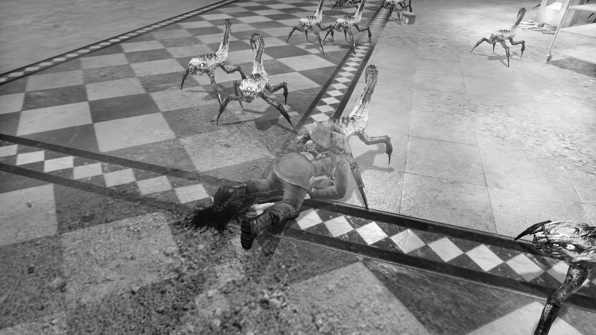
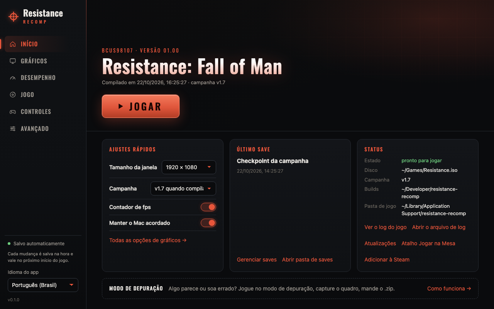
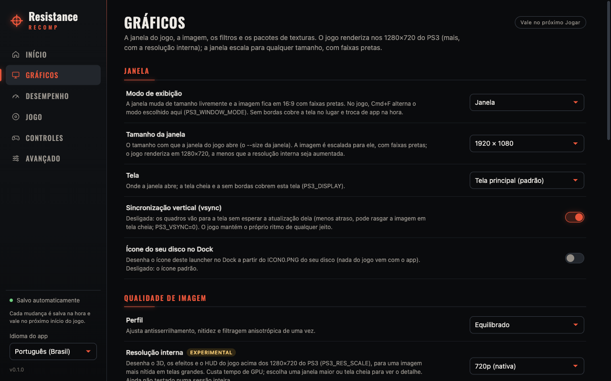

# Resistance: Fall of Man — recompilação estática para PC (macOS)

🌐 [English](README.md) · **Português (BR)**

Port nativo do **Resistance: Fall of Man** (PS3, disco `BCUS98107`) para
**macOS/arm64**, feito com recompilação estática: o código PowerPC e SPU do
jogo é traduzido para C/C++ e compilado como executáveis nativos, com
gráficos em Metal. Não é um emulador.

**Ele é jogável.** A campanha já foi jogada com controle de York, passando
por Grimsby e Manchester, até Nottingham ("Viper's Nest"), a uns 30 fps, a
meta do próprio jogo, e todas as 30 fases dela carregam até o gameplay.
Baixe o app na
[página de releases](https://github.com/erikomis/resistance-recomp/releases):
você escolhe a imagem do seu disco e ele monta o jogo a partir dela
([como](#baixar-e-jogar)).

| | |
| --- | --- |
| [](docs/screenshots/01-title-screen.jpg)<br>Tela de título | [](docs/screenshots/02-main-menu.jpg)<br>Menu principal |
| [](docs/screenshots/03-york-river.jpg)<br>York: "A Lone Survivor" | [](docs/screenshots/04-manchester-cathedral.jpg)<br>Manchester: "The Cathedral" |
| [](docs/screenshots/05-cathedral-leapers.jpg)<br>Leapers na catedral | |

<sub>Quadros do próprio port rodando num Mac com Apple silicon, montado a
partir do disco do jogador, na resolução do jogo, 1280×720. Resistance: Fall
of Man © Sony Interactive Entertainment, desenvolvido pela Insomniac Games;
mostrado só para documentar o port.</sub>

Construído sobre o [ps3recomp](https://github.com/sp00nznet/ps3recomp),
seguindo o [port do inFAMOUS 2](https://github.com/erikomis/infamous2-recomp)
do mesmo autor. Veja [CREDITS.pt-BR.md](CREDITS.pt-BR.md).

> [!WARNING]
> **Alpha, ainda não jogado até o fim.** A campanha foi jogada até
> Nottingham; dali em diante (de Cheshire em diante) as fases carregam, mas
> ninguém as jogou na mão. Só macOS com
> Apple silicon. O controle é o jeito testado de jogar. O que falta está no
> [ROADMAP.pt-BR.md](ROADMAP.pt-BR.md).

> **Este repositório não contém dados do jogo, firmware, chaves da Sony nem
> nada traduzido a partir deles.** Cada um gera tudo isso localmente a partir
> da própria cópia legítima. As chaves de descriptografia são baixadas na
> hora da compilação, do código-fonte público do RPCS3, só para
> descriptografar o seu disco. Projeto de fã, sem vínculo com a Sony
> Interactive Entertainment ou a Insomniac Games.

## Estado

| | |
| --- | --- |
| Boot, telas legais, instalação da primeira execução, tela de título, menus | ✅ |
| Campanha: York, Grimsby, Manchester e Nottingham, jogados com um DualSense | ✅ primeira pessoa, HUD, inimigos, morrer e renascer, Salvar e Sair e Continuar (até "Viper's Nest", 2026-11-10) |
| O resto da campanha (de Cheshire à Chimeran Tower) | 🧪 todas as fases carregam até o gameplay sem erros; ainda não jogadas na mão |
| Desempenho | ✅ uns 30 fps jogando, a meta do jogo; ✅ o combate pesado em "Outgunned" foi de 23–29 para uns 40 fps sem janela (2026-11-11, o trabalho do engine de desenho do port do Resistance 2), falta confirmar jogando; 🧪 um patch opcional de 60 fps (~88 fps em York; as três fases mais pesadas agora rodam a 44–56 fps sem limite, 2026-11-11) |
| Vídeos, música e som (AC3 5.1, mixado para a sua saída) | ✅ |
| Gráficos | ✅ as cores do mundo, sombras, névoa, água e a camada de grama; ⚠️ os pontos escuros em algumas árvores ainda precisam ser conferidos |
| Uma janela só dos menus até a campanha | ✅ fechá-la encerra o jogo na hora |
| Controle (DualSense, DualShock 4; Xbox One/Series pelo SDL), vibração | ✅ DualSense; 🧪 Xbox e vibração ainda não testados com um controle físico |
| Teclado e mouse (remapeáveis) | 🧪 mapeados, ainda não testados jogando |
| Menu dentro do jogo (F1 / Cmd+, / L3+R3): imagem, áudio, controles, HUD de desempenho, Sair do jogo | 🧪 novo na v0.3.0, testado sem janela pelos menus e no gameplay; falta uma sessão com janela |
| Tela dividida offline (cooperativo e versus) | ✅ |
| Saves, Continuar a partir de um checkpoint | ✅ |
| Atualização v1.7 do jogo na campanha | ✅ quando você tem os arquivos da atualização; os menus continuam na 01.00 |
| O app: instalação com um clique a partir do seu disco, recompilação, jogar, ajustes, saves | ✅ |
| Multiplayer online | ❌ fora do escopo (os servidores oficiais acabaram) |
| Linux e Windows | ⏳ sem suporte (existe uma prévia do launcher para Windows; o jogo em si só compila no macOS) |

A tabela completa, com o que foi cada correção, está em
[docs/TECHNICAL.pt-BR.md](docs/TECHNICAL.pt-BR.md#estado). Os próximos passos
estão no [ROADMAP.pt-BR.md](ROADMAP.pt-BR.md).

## Baixar e jogar

Você precisa de um Mac com Apple silicon, do seu próprio disco do
**Resistance: Fall of Man** (`BCUS98107`, EUA) copiado para uma imagem
`.iso`, de internet na primeira vez e de uns 4 GB livres.

1. Baixe o `.dmg` na
   [página de releases](https://github.com/erikomis/resistance-recomp/releases)
   (todos os releases até agora são pré-releases) e arraste o app para
   Aplicativos. Ele não é notarizado: na primeira vez, clique com o botão
   direito > Abrir (ou Ajustes do Sistema > Privacidade e Segurança > Abrir
   Assim Mesmo).
2. Abra e aperte **Instalar o jogo**, depois escolha a sua `.iso`. Se o seu
   Mac ainda não tiver as Ferramentas de Linha de Comando da Apple, o macOS
   pede para instalá-las (um clique); o app espera e continua sozinho.
3. O app faz o resto sozinho, com uma barra de progresso: baixa o código do
   port, as ferramentas de compilação (sem Homebrew) e as chaves de
   descriptografia, descriptografa os dois executáveis do seu disco e
   compila o jogo. Uns 7 minutos num Mac recente, até 30 num mais lento. Se
   algo falhar, ele diz o porquê em palavras simples, e apertar o botão de
   novo continua de onde parou.
4. Aperte **Jogar**. No primeiro boot aperte START duas vezes: a tela legal,
   depois a "configuração inicial" que o jogo instala uma vez só.

O release não traz nenhum arquivo do jogo: o app monta o jogo no seu Mac a
partir do seu disco. A campanha roda a 01.00 do disco, a menos que você
também tenha os arquivos da atualização v1.7 do jogo
([como](docs/TECHNICAL.pt-BR.md#a-campanha-v17)).

## O app

O [`launcher/`](launcher/README.md) é um app de desktop (Tauri) que faz tudo
isso sem terminal: Início (a arte do seu disco, JOGAR, ajustes rápidos,
último save, estado), Gráficos, Desempenho, Jogo, Controles e Avançado.

- **Instalar o jogo** com um botão, e **recompilar** depois de uma
  atualização.
- **Se atualiza sozinho** (a partir da v0.3.0): o card Atualizações no Início
  oferece **Baixar e instalar**, depois **Reiniciar para concluir** (assinado
  e conferido), e em seguida **Recompilar o jogo**. O mesmo card avisa quando
  o port tem fontes novas: **Baixar as fontes novas** e depois **Recompilar o
  jogo** é como uma correção chega a um jogo já instalado (saves e ajustes
  ficam). A v0.2.2 e as anteriores não têm atualizador: instale a v0.3.0 na
  mão uma vez.
- **Gráficos:** janela, tela cheia ou sem borda, vsync, filtros (FXAA, SMAA,
  nitidez), MetalFX, pacotes de texturas, as opções de 60 fps e de campo de
  visão.
- **Controles:** remapear teclado, mouse e controle, vibração; **áudio**:
  volume, mudo e saída.
- **Saves:** listar, fazer backup, restaurar, importar/exportar, `.zip`.
- **Modo de depuração:** jogue normalmente enquanto o jogo registra o que dá
  errado; **Capturar este quadro**, depois **Analisar** e **Criar .zip** para
  um relatório. Mais um visualizador do log do jogo.
- **Atalho para jogar** na Mesa e **Adicionar à Steam** (Big Picture com o
  controle).

**No jogo,** F1 (fn+F1), Insert, Cmd+, ou L3+R3 abre o **menu do jogo**
(vindo do port do inFAMOUS 2): imagem (gama, nitidez, FXAA/SMAA, vibração das
cores, contraste, vinheta, granulado, MetalFX, vsync, modo de janela,
resolução interna), volume do áudio, controles (remapeamento ao vivo de
teclado, mouse e controle, vibração, mouse), um HUD de desempenho (fps, tempo
de quadro, CPU e GPU) e **Sair do jogo**, que nunca fecha o jogo no meio de
um save. O que você muda fica guardado para a próxima vez. Detalhes em
[docs/TECHNICAL.pt-BR.md](docs/TECHNICAL.pt-BR.md#menu-dentro-do-jogo).

| | |
| --- | --- |
| [](launcher/docs/screenshots/home.png) | [](launcher/docs/screenshots/graphics.png) |

## Problemas conhecidos

- **Quedas de fps em "Outgunned"** (Manchester): o combate grande ao ar
  livre (uns 2.500 draws por quadro) ficava em 13–15 fps jogando. Corrigido
  no código em 2026-11-11 com o trabalho do engine de desenho do port do
  Resistance 2: medido sem janela no mesmo ponto, 23–29 fps antes, uns 40
  depois. A thread do RSX passava 39% do tempo esperando a GPU (os shadow
  maps eram lidos de volta pela CPU a cada quadro). Falta confirmar jogando.
  Já instalou? Início > Atualizações > **Baixar as fontes novas** e depois
  **Recompilar o jogo**.
- **Grama sumindo ou piscando** em alguns lugares: a tabela de alvos de
  renderização do engine enchia nas cenas pesadas e descartava alvos ainda
  em uso, o que perde o que a GPU desenhou neles. Agora ela tem 512 vagas
  (tinha 64, depois 128; `PS3RECOMP_ENG_SURFACE_SLOTS` muda isso). Falta
  confirmar jogando que a grama fica.
- **Fases pesadas:** "The Cathedral", "No Way Out" e "Ice and Iron" são as
  mais lentas. Com o trabalho do engine de desenho do Resistance 2 elas foram
  de uns 25 fps sem limite para 47, 44 e 56 (sem janela, 2026-11-11): 30 fps
  com folga, mas não 60 estáveis com a opção de 60 fps.
- **Pontos escuros** em algumas árvores: a camada de grama foi corrigida em
  2026-11-06; as árvores ainda precisam ser conferidas.
- **Os menus continuam na 01.00:** só a campanha roda a atualização v1.7 (o
  executável de menus da atualização só existe na versão digital).
- **Travamentos raros:** cerca de 1 execução de teste em 10 travou (3 em
  umas 25, 2026-11-11). O job manager das SPUs para de pegar jobs e o jogo
  avisa no log ("Physics SPU Collision Timed Out!", "WwsJobDelay timed
  out"); duas execuções de 10 minutos de "No Way Out" logo depois foram
  limpas, então a causa ainda não foi achada. O jogo agora grava um
  **relatório de travamento** no log depois de 30 s sem quadro (todas as
  threads e SPUs, e onde cada uma espera). Se acontecer com você, mande o log
  (Modo de depuração > Criar .zip, ou o `last.log`).
- **Teclado e mouse, vibração, controle de Xbox:** implementados, ainda não
  testados jogando.
- **Multiplayer online** não funciona (os servidores acabaram); a tela
  dividida offline funciona.

## Em andamento

O que está sendo feito agora (detalhes no [ROADMAP.pt-BR.md](ROADMAP.pt-BR.md)):

- **Jogar a campanha inteira:** jogada até Nottingham ("Viper's Nest"); a
  próxima é Cheshire.
- **Velocidade nas cenas pesadas:** o trabalho do engine de desenho do
  Resistance 2 entrou (uns +40% em "Outgunned"); o que limita agora é a CPU
  decodificando os comandos e preparando os draws na thread do RSX.
- **O travamento raro** em que o job manager das SPUs para: o relatório de
  travamento está no jogo para pegá-lo.
- **A grama** que some ou pisca: falta confirmar com a tabela de alvos
  maior.
- **A iluminação da neve** em "Ice and Iron".
- **Pull requests no [ps3recomp](https://github.com/sp00nznet/ps3recomp)**
  com as correções do toolkit feitas aqui.

## Compilando a partir do código

O app faz tudo isso por você. Para fazer na mão, você precisa das Xcode
Command Line Tools (`xcode-select --install`) e do disco montado:

```sh
git clone https://github.com/erikomis/resistance-recomp.git
cd resistance-recomp
PS3_VFS_ROOT=/Volumes/<seu disco> tools/install.sh
tools/play.sh
```

O `tools/install.sh` coloca as ferramentas de compilação em
`~/Library/Application Support/resistance-recomp/deps` (sem Homebrew),
prepara o toolkit, descriptografa, traduz e compila; rode de novo e ele
continua de onde parou. Cada etapa, a campanha v1.7 e as variáveis de
ambiente estão em
[docs/TECHNICAL.pt-BR.md](docs/TECHNICAL.pt-BR.md#compilando-a-partir-do-código).

## Correções feitas aqui

As mudanças no toolkit estão em
[`patches/ps3recomp-a6d76c8-resistance.patch`](patches/ps3recomp-a6d76c8-resistance.patch),
aplicado pelo `tools/setup_toolkit.sh`. As que fizeram o jogo andar:

- **Chegar ao gameplay:** o módulo de política do job manager WWS e o
  agendamento do SPURS, as SPUs raw, pilhas de callback por thread (o
  travamento depois da abertura).
- **O mundo azul:** o wrap de 28 bits do offset de vértice do RSX.
- **Renascer no céu:** uma parada de SPU raw que o runtime descartava.
- **O Continuar travava:** uma área de parâmetros da SPU raw que muda a cada
  checkpoint.
- **Grimsby travava, o Location Select fechava o jogo:** o caminho do cache
  do sistema, e o `setjmp`/`longjmp` do Lua (uma opção nova do lifter).
- **Vídeos sem som:** AC3 5.1 pelo FFmpeg.
- **Velocidade:** um cache de vértices (de 5,9 para 14 fps em York), a
  profundidade resolvida na GPU e o trabalho do engine de desenho do port do
  Resistance 2: profundidade e blits copiados na GPU em vez de lidos de
  volta, mais uma correção nossa para os alvos de renderização pequenos que
  o jogo cria a cada quadro ("Outgunned" de 23–29 para uns 40 fps).
- **Fechar a janela encerra o jogo, controles de Xbox:** uma saída limpa que
  espera um save em andamento; controles Xbox One/Series lidos como HID, não
  pelo MFi.
- **Névoa, água, sombras, tela dividida, a camada de grama:** a origem da
  janela, comparações de profundidade, descarte de superfícies, limpezas com
  scissor, o alpha test.
- **De outros ports:** correções do
  [port do inFAMOUS 2](https://github.com/erikomis/infamous2-recomp), do port
  do Resistance 2 e do
  [port deste jogo para Windows](https://github.com/Psyykosis/Resistance-Fall-of-Man-Recomp)
  feito por Psyykosis (créditos no [CREDITS.pt-BR.md](CREDITS.pt-BR.md)).
- **Devolvidas ao upstream:** pull requests no ps3recomp (limpezas com
  scissor, o polygon offset, posições invariantes, `cellSysconf`, o modo de
  sensor do controle e outros; veja o
  [ROADMAP.pt-BR.md](ROADMAP.pt-BR.md#retribuindo)).

## Organização

| Caminho | O que é |
| --- | --- |
| [`port/`](port/) | O código específico do jogo: boot, exitspawn, os patches opcionais do jogo, registro das SPUs |
| [`patches/`](patches/) | O patch do toolkit |
| [`tools/`](tools/) | Scripts de instalação, recompilação, descriptografia, jogo e captura |
| [`launcher/`](launcher/) | O app |
| [`docs/`](docs/) | Notas técnicas e prints |

## Licença

O código do próprio port é MIT ([LICENSE](LICENSE)); o ps3recomp mantém a
licença dele. Resistance: Fall of Man pertence à Sony Interactive
Entertainment; nenhuma parte do jogo está incluída.
