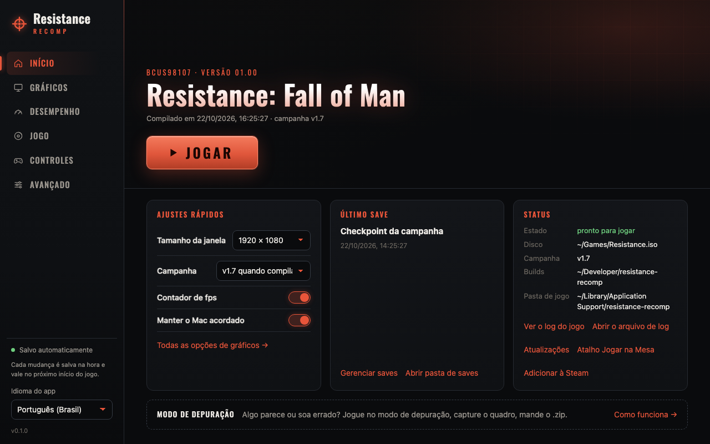
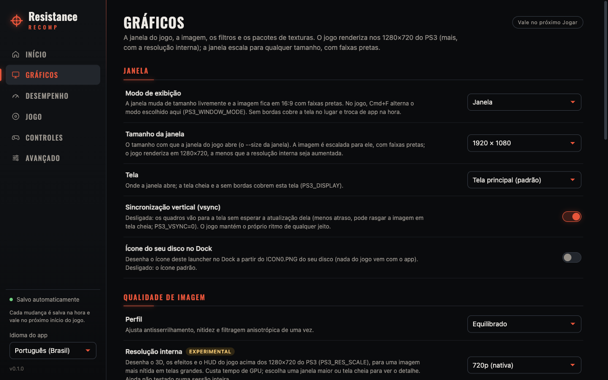
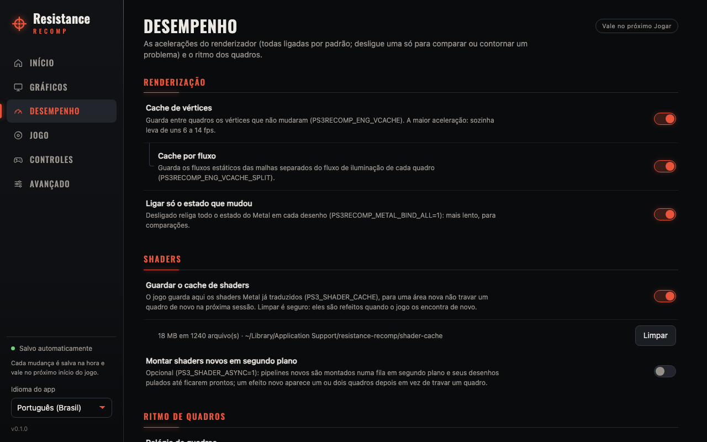
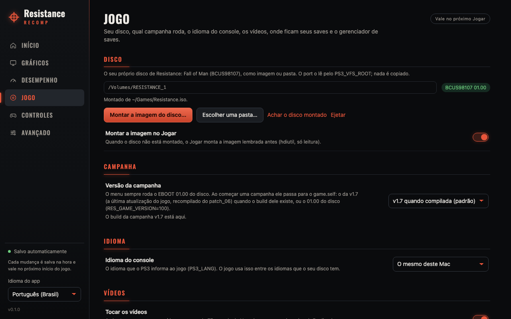
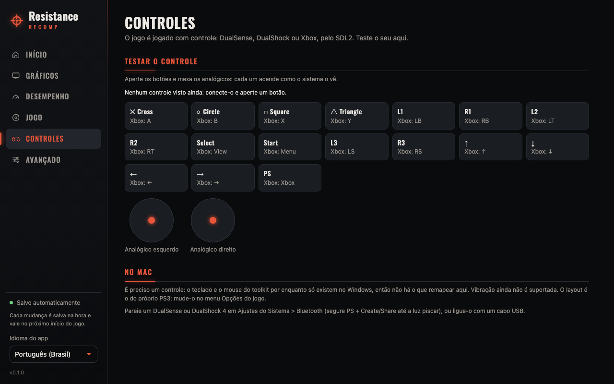
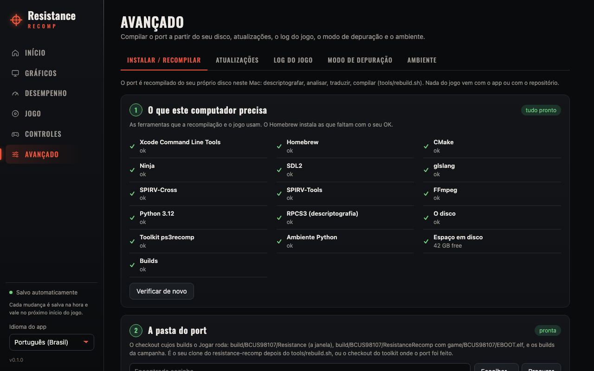
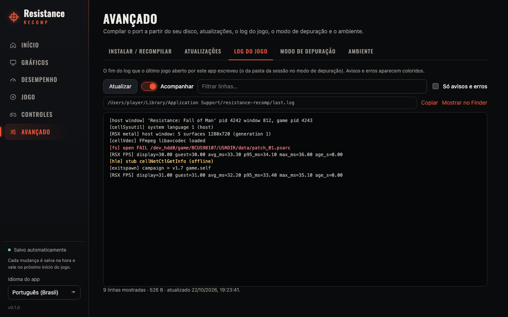
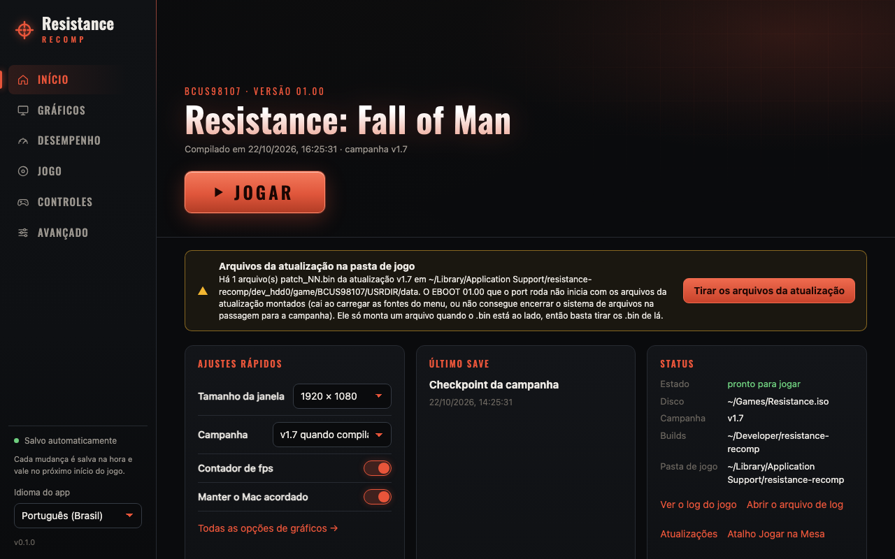

# Launcher (Tauri)

A desktop app that takes the player from their own Resistance: Fall of Man
disc (BCUS98107) to "Play" without a terminal: it finds the port's builds and
the disc, mounts the disc image, keeps the game's settings, runs the rebuild
with a progress bar and starts the game the way `tools/play.sh` does. It ships
no game code or files; the cover art on the home screen is read from the
player's mounted disc (`PS3_GAME/ICON0.PNG`, `PIC1.PNG`).

It is modelled on the [inFAMOUS 2 port's
launcher](https://github.com/erikomis/infamous2-recomp/tree/main/launcher)
and keeps its look, its layout and most of its code (Play shortcut, Add to
Steam, the Dock icon from the player's copy, debug mode, the saves manager,
the log viewer), adapted to this port. Made for Apple-silicon macOS, like
the game; a Windows x64 build is published as an untested preview (below).

## What the player does

1. **Home > Install the game** (shown until the game is built): choose the
   disc image (`.iso`) and press the button. The app checks the free disk
   space (4 GB asked; a full install leaves about 1.5 GB) and says how long it
   takes (about 7 minutes measured on a 12-core Mac, 10 to 30 elsewhere), opens
   Apple's Command Line Tools installer when they are missing
   (`xcode-select --install`) and waits for it (polling every 5 s), clones the
   sources into `~/Library/Application Support/resistance-recomp/src` when
   there is no checkout (at the tag `v<launcher version>` when it exists, on
   the default branch so Updates can pull; `RES_SOURCES_URL` overrides the
   repository), then runs `tools/install.sh`: `tools/bootstrap_deps.sh` (CMake,
   Ninja, Python 3.12, SDL2, SPIRV-Tools, glslang, SPIRV-Cross, FFmpeg into
   `<data>/deps`, no Homebrew), the toolkit, the venv, decrypt, analyse, lift,
   SPU, build. One progress bar with the stage's name and a time estimate;
   **Cancel**; on a failure a plain-language reason by stage (no internet, a
   full disk, the disc, the compile...) with **Copy log**, **Show the log
   file** (`<data>/install.log`) and **Report a problem** (the log's end
   copied, a new GitHub issue opened). Pressing it again after a quit or a
   failure continues where it stopped: what is installed is skipped, analyse,
   lift and SPU run only when their inputs changed, the build is incremental.
   Quitting the app stops the install (its own process group, by pid).
   Power users: **Advanced > Install / rebuild** lists what the Mac needs
   (Xcode Command Line Tools; the build tools, from `tools/bootstrap_deps.sh`
   with **Install the build tools**, or Homebrew's when it has them all; RPCS3
   only as an optional fallback) and runs `tools/rebuild.sh` with the chosen
   steps (installing the build tools first when they are missing). Or build
   from a terminal (main README, "Building from source").
2. **Game > Disc**: **Mount the disc image…** picks the `.iso` and attaches
   it read-only (`hdiutil attach -readonly`); the image is remembered and
   mounted again on Play when it is not (setting "Mount the image on Play").
   A folder holding `PS3_GAME/` works too, and without either the first
   BCUS98107 volume under `/Volumes` is used (as `tools/env.sh` finds it).
3. **Play** on Home. On the first boot of a play folder, press START twice
   (the legal screen, then the "initial setup" HDD install).

## Screens

Screenshots (1280×800, `scripts/ui-mock.js` backend, no game art):

| | |
|---|---|
|  |  |
|  |  |
|  |  |
|  |  |

More in `docs/screenshots/` (English Home, each Advanced tab).

**Settings are saved the moment they change** (`launcher.json`) and apply the
next time the game starts.

- **Home / Início**: a hero with the player's own disc art when it is
  mounted, else a plain styled title; "BCUS98107 · version 01.00", the build
  date and the campaign that will run; **Play** (Stop while the game runs;
  **Capture this frame** in debug mode). A bar for whatever blocks Play,
  with its fix: no builds (to Install / rebuild), no disc (mount an image or
  pick a folder), a disc that is not BCUS98107, or the v1.7 update's
  `patch_NN.bin` files in the play folder's `USRDIR/data`: the 01.00 EBOOT
  cannot run with the update's archives mounted (as `jogar.sh` warns), so
  Play refuses and **Move the update files aside** moves them to
  `<play>/update-files-aside/<time>/` (nothing deleted). A first-boot hint
  (two STARTs), a bar when Updates has news. Cards: **Quick settings**
  (window size, campaign, fps counter, keep the Mac awake), **Last save**,
  **Status** (state, disc, campaign, builds, play folder; links to the log,
  Updates, **Play shortcut on the Desktop**, **Add to Steam**).
- **Graphics / Gráficos**: the window: display mode (`PS3_WINDOW_MODE=
  fullscreen|borderless`; windowed is the default and passes nothing), window
  size (`--size WxH` of the window host, which letterboxes the picture),
  screen (`PS3_DISPLAY`, by the names `NSScreen` gives), vsync (`PS3_VSYNC=0`
  when off), "Your disc's icon in the Dock" (and "Use as the app's Finder
  icon"); image quality: profile, internal resolution (`PS3_RES_SCALE=1.5|2|3`,
  labelled experimental), MetalFX upscaling (`PS3_UPSCALE=metalfx`), FXAA or
  SMAA (`PS3_AA`), sharpening (`PS3_SHARPEN`), anisotropic filtering
  (`PS3_ANISO`), gamma override (`PS3_DISPLAY_GAMMA`); filters: vibrance,
  contrast, vignette, grain (`PS3_VIBRANCE`, `PS3_CONTRAST`, `PS3_VIGNETTE`,
  `PS3_GRAIN`), a colour LUT file and its strength (`PS3_LUT`,
  `PS3_LUT_STRENGTH`); texture packs: the folders in `<data>/mods`, ticked
  and ordered (`PS3_MODS_DIR`, `PS3_MODS`, first wins), and **Dump the
  game's textures** (`PS3_MODS_DUMP=<data>/texture-dump`).
- **Performance / Desempenho**: vertex cache (`PS3RECOMP_ENG_VCACHE=0` when
  off) and its per-stream split (`PS3RECOMP_ENG_VCACHE_SPLIT=0`), bind only
  changed state (`PS3RECOMP_METAL_BIND_ALL=1` when off), the shader cache
  (`PS3_SHADER_CACHE=<data>/shader-cache`, on by default, with its size and
  **Clear**), async shaders (`PS3_SHADER_ASYNC=1`, opt-in), the frame clock
  (`PS3_FRAMECLOCK_US`), the frame-rate counter (`PS3RECOMP_METAL_FPS=1`, on
  as in `play.sh`), keep the Mac awake (`caffeinate -i`, on as in `play.sh`);
  **60 fps and field of view** (below).
- **Game / Jogo**: the disc (path, the image it is mounted from, mount,
  folder, find, eject, mount on Play); the **campaign version**: "v1.7 when
  built" (the exitspawn switches to `build/BCUS98107_game_v17` with
  `game/BCUS98107/modules_v17/game.elf` when both exist, made by
  `tools/rebuild.sh v17`; the menus stay the disc's 01.00 EBOOT) or "01.00"
  (`RES_GAME_VERSION=100`), with whether the v1.7 build is there; the console language (`PS3_LANG`, empty = the Mac's);
  movies (`PS3RECOMP_FFMPEG=0` when off, and the `PS3RECOMP_FFMPEG_AVCODEC` /
  `_AVUTIL` paths, the install's `<data>/deps/lib` by default, else Homebrew's); the play folder (empty =
  `~/Library/Application Support/resistance-recomp`, `play.sh`'s
  `RES_DATA`); **audio**: volume (`PS3_AUDIO_VOLUME` 0-100, passed below
  100), mute (`PS3_AUDIO_MUTE=1`) and the output device (`PS3_AUDIO_DEVICE`,
  part of its name; empty = the system's default; macOS only, the Windows
  backend has no device choice); the **saves manager** (below).
- **Controls / Controles**: the bindings table, PS3 control by keyboard,
  mouse button and controller, with what each does in Resistance (R1 fire,
  L1 aim, L2 grenade, ✕ jump, ○ crouch, □ reload/use, △ switch weapon,
  START pause, left stick move, right stick look). Click a cell and press
  the input; it is written at once to `<data>/input.toml` (the toolkit's
  `libs/input/pad_input_map.h` format, the same file the inFAMOUS 2 launcher
  writes: `[keyboard]`, `[mouse_buttons]`, `[controller]`, any other section
  kept), which Play passes as `PS3_INPUT_MAP`. Until a binding changes there
  is no file and the game's built-in layout applies; **Restore defaults**
  moves the file to `input.toml.bak`. Pressing keys, mouse buttons or
  controller buttons lights the rows they drive, and the controller test
  below shows the pad's name and both sticks. Then: what drives the game
  (`PS3_INPUT_MODE=controller|keyboard`; both is the default), the mouse
  (camera on/off `PS3_MOUSE=0`, `PS3_MOUSE_SENS`, `PS3_MOUSE_INVERT_Y`,
  `PS3_MOUSE_INVERT_X`, `PS3_MOUSE_DEADZONE` 0-120, cursor capture
  `PS3_MOUSE_CAPTURE=0`) and vibration (`PS3_RUMBLE=0`,
  `PS3_RUMBLE_STRENGTH` 0-200 %). A hand-written `[mouse]` section in the
  file makes Play pass every mouse setting, so the page's stand.
- Every setting is passed only when it differs from the runtime's default:
  with the defaults, Play starts the game exactly as before these settings
  existed. A section whose feature the build lacks (the builds' executables
  are searched for the variable's name) says to rebuild instead.
- **Advanced / Avançado**, five tabs:
  - **Install / rebuild**: 1. the requirements (**Install the build tools**:
    `tools/bootstrap_deps.sh` streamed to the window; Apple's CLT installer;
    Homebrew and RPCS3 are not needed); 2. the port folder (below); 3. the
    rebuild: the steps (decrypt, analyse, lift, SPU, build; the toolkit and a
    Python venv always come first), JOBS, a progress bar with a time
    estimate, the step list and the log; **Cancel** stops it and everything
    it started.
  - **Updates**: the port checkout (branch, commit, `git fetch`, commits
    behind its upstream, **Get the new sources** = `git pull --ff-only`,
    refused with local changes) and "the sources changed after the builds"
    (the newest commit touching `port/`, `patches/` or `tools/` against the
    EBOOT build's time) with **Rebuild the game**; the launcher itself
    (see [App updates](#app-updates)): a newer version is offered with
    **Download and install**, then **Restart to finish**, and the new
    version offers **Rebuild the game**. Once per session on start when
    **Check for updates when the app opens** is on; `RES_NO_UPDATE_CHECK=1`
    turns the launcher check and the install off.
  - **Game log**: the end of `last.log` (or the debug session's log), at
    most 512 KB, followed every 2 s, a filter, warnings and errors only,
    copy, show in Finder.
  - **Debug mode**: see below.
  - **Environment**: extra variables (passed last, so they win; the main
    README's environment table), quiet log (`PS3_VERBOSE=0`), the equivalent
    command line, Restore defaults.
- UI in Brazilian Portuguese (default) and English (sidebar), English as the
  fallback for a missing string.

## How it fits together

```
launcher (Rust, src-tauri/src/lib.rs)
 ├─ Install → zsh in <data>: [git clone → <data>/src,] tools/install.sh
 │            (bootstrap_deps.sh → <data>/deps, toolkit, venv, decrypt … build;
 │            resumable; its output also in <data>/install.log)
 ├─ Rebuild → zsh in the port folder: [tools/bootstrap_deps.sh,] tools/rebuild.sh toolkit,
 │            python3.12 -m venv .venv + pip install -r ps3recomp/requirements.txt (once),
 │            PY=.venv/bin/python tools/rebuild.sh <steps>   ("==> step" lines: src/progress.ts)
 └─ Play    → cd <play folder> &&
              [caffeinate -i] build/BCUS98107/Resistance [--size WxH] --
                  build/BCUS98107/ResistanceRecomp game/BCUS98107/EBOOT.elf  > last.log 2>&1
```

- **The port folder** is a checkout with `build/BCUS98107/{Resistance,
  ResistanceRecomp}`, `build/BCUS98107_game/ResistanceRecomp` (and
  optionally `build/BCUS98107_game_v17/`) and `game/BCUS98107/EBOOT.elf`,
  `modules/game.elf` (optionally `modules_v17/game.elf`): this repository
  after `tools/rebuild.sh`, or the toolkit checkout the port was developed
  in. It must keep that layout: the exitspawn to the campaign runs the
  sibling build directory with the ELF under `game/BCUS98107` of the same
  checkout (`port/stubs.cpp`). Empty setting = found on its own: `RES_ROOT`,
  the repository the launcher was built from, then any folder one level under
  `~/Desktop`, `~/Developer`, `~/Documents`, `~/Projects`, `~/src`, `~/code`,
  `~/git` or `~` that has `build/BCUS98107`, complete builds and the newest
  first; `<data>/src`, where Install the game clones the sources, is one of
  them. A build from before the rename (`MyGameRecomp`) is used when it is
  the only one. Rebuilding needs the folder to have `tools/rebuild.sh`.
- **Play's environment**: `PS3_VFS_ROOT` (the disc), `PS3_HDD0_ROOT` /
  `PS3_HDD1_ROOT` (`<play>/dev_hdd0`, `dev_hdd1`), the FFmpeg paths, then
  only the settings that differ from the port's defaults, then the extra
  variables. It drops an inherited `PS3RECOMP_METAL_HEADLESS`,
  `PS3RECOMP_HOST_SURFACES`, `PS3RECOMP_WINDOW_STATE` and
  `RES_GAME_VERSION`. A GUI app starts with a bare `PATH`; the build tools'
  `<data>/deps/bin` (`RES_DEPS`), then Homebrew's folders go in front. FFmpeg
  is `<data>/deps/lib`'s when it is there, else Homebrew's; SDL2 is found by
  the absolute install name the build linked.
- **Stop** sends SIGTERM to the process group Play started (the window host
  closes the game, then itself), and SIGKILL to that group 8 s later if it
  is still there. Processes are never looked up by name to be signalled; a
  `ResistanceRecomp` started elsewhere is only shown ("running, started
  outside the launcher") and keeps the saves manager read-only.
- Settings live in `~/Library/Application Support/resistance-recomp/launcher.json`,
  next to the default play folder.

## Saves

`src-tauri/src/saves.rs`. Resistance keeps two kinds of save:

- the **profile**, a cellSaveData slot (`BCUS98107_PROFILE`: PARAM.SFO,
  ICON0.PNG, PROFILE.SAV), under `<play>/gamedata/dev_hdd0/home/00000001/savedata`
  (the toolkit's cwd-relative `./gamedata`, or `PS3_GAMEDATA_ROOT`) and
  RPCS3's `dev_hdd0/home/<user>/savedata`;
- the **campaign checkpoint**, `quick.sav`, a plain file in the game's data
  folder (`dev_hdd0/game/BCUS98107/USRDIR/`), in the port and in RPCS3.

Both sides are listed side by side, with "same as / differs from the other
side". Back up one or all, copy either way, delete, export to `.zip`, import
a `.zip` (an RPCS3 `savedata` zipped works), restore a backup. Backups go to
`<data>/save-backups/<UTC time>-<side>-<reason>/` with `backup.json`; one is
made before every Play (skipped when nothing changed; the newest N kept,
default 10, 0 = off) and before every restore, copy, import and delete. A
slot is built next to the old one and swapped in by renaming. The game's
files are copied byte for byte; crossing sides converts only the metadata:
the port's `PARAM.PFD` (the SECUREFILE names, one per line) becomes RPCS3's
`*<file>` keys and `RPCS3_BLIST` in PARAM.SFO, and back (RPCS3's own
PARAM.SFO is kept when it already has the slot). Everything refuses while
the game runs.

## Debug mode

`src-tauri/src/report.rs`, Advanced > Debug mode. **Play in debug mode**
starts the game as Play does, with its log and dumps in a new folder
`<data>/reports/<UTC time>/`:

| Variable | What it adds |
|---|---|
| `PS3RECOMP_METAL_FRAME_DUMP=<dir>/frame.ppm` | the whole frame every 120 presents |
| `RSX_ENGINE_PASS_DUMP=<dir>/passes`, `RSX_ENGINE_PASS_DUMP_TRIGGER=<dir>/.dump-now`, `RSX_ENGINE_PASS_DUMP_DRAWS=1` | on the first capture, the next frame pass by pass: each pass's render targets and depth, `passes.txt`, one line per draw in `draws.txt` |
| `PS3RECOMP_METAL_FPS=1`, `PS3RECOMP_HOST_STATS=1` | the frame rate and frame times, the window's latency and dropped frames |
| `LV2_ERRDBG=1` | each failing syscall, once per (number, error) |
| `AUDIO_RATE=1` | every 5 s: mixed audio vs real time |
| `PS3_VERBOSE=1` | the runtime's per-event lines |

**Capture this frame** keeps the latest whole frame as `shots/shot<n>.ppm`
and touches the trigger; `events.tsv` indexes the session (start, a tick
every 2 s with the log's size, captures, stop, exit), `system.txt` has the
Mac, macOS, GPU, the disc, the builds and the command and variables. After a
crash the macOS crash report (`ResistanceRecomp-*.ips` or `Resistance-*.ips`)
is copied as `crash.ips`. **Analyse** groups the log's error and warning
lines by message (numbers masked), most frequent first, with the frame rate
from the `[RSX FPS]` lines (`triage.md`, `triage.json`). **Create .zip**
packs the folder (PPM/PGM as PNG, the home folder's path as `~`, the
optional description as `notes.txt`) to attach to an issue.

## The Play shortcut and Add to Steam

As in the inFAMOUS 2 launcher (`play_shortcut.rs`, `steam.rs`, `vdf.rs`,
`steam_art.rs`): `--play` on the command line starts the game once the
window is up (`open -b io.github.erikomis.resistancerecomp --args --play`);
Home > Status > **Play shortcut on the Desktop** writes `~/Desktop/Play
Resistance.app` running that line. **Add to Steam** (Steam installed, the
packaged app) writes a non-Steam entry "Resistance: Fall of Man" into every
account's `shortcuts.vdf` (backed up first, other entries untouched; Steam
must be closed, the app offers to quit it), with library art drawn at that
moment from the player's own `ICON0.PNG` and `PIC1.PNG`; the entry runs
`--play --exit-with-game`, so Steam sees the game exactly as long as it runs.
**Remove from Steam** takes it out again.

## Development

Needs Node 20+, Rust (stable) and the Xcode Command Line Tools.

```sh
cd launcher
npm install
npm run tauri dev        # the app, with the frontend hot-reloaded
npm run tauri build      # .app and .dmg in src-tauri/target/release/bundle/
npm run typecheck        # frontend only
(cd src-tauri && cargo test)
```

Or from the repository root: `tools/rebuild.sh launcher` builds the `.app`
into `build/launcher/` (`CARGO_TARGET_DIR` is honoured).

The screenshots in `docs/screenshots/` come from the built frontend in a
plain browser with a fake backend: `npm run build && npx vite preview --port
4173`, then load the page with `scripts/ui-mock.js` injected before it (e.g.
Playwright's `page.addInitScript({ path: "scripts/ui-mock.js" })`, at
1280×800); `window.__UI_MOCK__ = { noBuilds: true }`, `{ noDisc: true }`,
`{ running: true }`, `{ updateFiles: true }` or `{ lang: "en" }` in an
earlier init script shows those states.

`scripts/check_bundle.py <.app|.dmg>` fails when a bundle carries anything
from the game (names, PS3 file headers, PowerPC/SPU ELFs, big files);
`.github/workflows/launcher.yml` builds the app on `macos-14` and on
`windows-latest`, runs the tests and the check, and uploads the zipped
`.app` and the `.dmg`, and the Windows installers (NSIS `.exe`, `.msi`); on a
`v*` tag it attaches them to that GitHub release. The builds are not
code-signed: on macOS right-click the app and choose Open the first time
(Gatekeeper); on Windows SmartScreen may warn ("More info" > "Run anyway").

## App updates

The launcher updates itself on macOS (Apple silicon) with
[tauri-plugin-updater](https://v2.tauri.app/plugin/updater/)
(`src-tauri/src/update.rs`, `src/update.ts`):

1. **The check.** The app reads the update manifest `latest.json` from the
   first of `plugins.updater.endpoints` in `src-tauri/tauri.conf.json` that
   has one: the fixed `updater` release
   (`https://github.com/erikomis/resistance-recomp/releases/download/updater/latest.json`),
   then GitHub's "latest release" (which skips pre-releases, hence the fixed
   one). Once per session at start when the setting is on, and on **Check
   again**; with the system's `curl`, no token.
2. **Download and install.** The plugin downloads the `.app.tar.gz` the
   manifest names, checks its minisign signature against the public key
   (`plugins.updater.pubkey`; the signature must also carry the announced
   version, `requireSignedVersion`) and swaps the bundle in place. Refused
   while the game, a rebuild or an install runs, from a development build,
   from the disk image and from a translocated copy (macOS runs a downloaded
   app from a read-only place until it is moved to Applications); Play and
   the rebuild wait while it runs.
3. **Restart to finish** relaunches into the new version. The install left
   `app-updated.json` (from, to, when) in the launcher's folder; while the
   app is that version and the EBOOT build is older than the update,
   Updates and Home offer **Rebuild the game** (after **Get the new
   sources** when the checkout is behind). Settings, saves and the builds
   are never touched by the update.

Windows (preview) is not in the manifest: a newer version there is a link
to its release page.

**Releasing.** Bump the version in `src-tauri/tauri.conf.json`,
`src-tauri/Cargo.toml` and `package.json` (the tag's jobs fail when they
differ from the tag: `scripts/check_version.py`), commit, and push a `vX.Y.Z`
tag. `.github/workflows/launcher.yml` then:

- on macOS, with the repository secrets `TAURI_SIGNING_PRIVATE_KEY` and
  `TAURI_SIGNING_PRIVATE_KEY_PASSWORD`, builds with
  `--config src-tauri/tauri.updater.conf.json` (`createUpdaterArtifacts`),
  which adds `Resistance Launcher.app.tar.gz` and its `.sig` (a local
  `tauri build` without the key keeps working: the setting is only in that
  file);
- in the release job, names them `resistance-launcher_<v>_macos_aarch64.app.tar.gz`
  (+ `.sig`), writes `latest.json` with `scripts/updater_json.py make`
  (darwin-aarch64 only; it refuses a signature for another version) and
  attaches everything to the release;
- runs `.github/workflows/updater.yml`, which copies that `latest.json`
  (with the release's notes and date) to the `updater` release, made on
  first use. It never offers an older version than the current one, except
  when run by hand (Actions > updater > Run workflow, with a tag): that is
  the rollback. It also runs when a release is published by hand.

Without the secrets the release still gets its `.dmg`, `.app.zip` and
Windows installers, but no updater bundle: installed apps are not offered
it. `python3 scripts/test_updater_json.py` tests the manifest script; the
`update::tests` in `cargo test` check the manifest parsing and that the
endpoints and the key in `tauri.conf.json` are well formed.

**The signing key.** Made once with `npx tauri signer generate -w
<file>` (a password is asked; keep it). The public key goes into
`plugins.updater.pubkey`; the private key file's contents and its password
are the two secrets above and are kept nowhere in the repository. Losing the
private key means installed apps can no longer be updated (a new key needs a
manual download of the version that carries it).

## Windows (preview)

The launcher compiles and runs on Windows x64; the port itself has only been
built and played on macOS, so the app shows an "experimental" banner there.
What differs from macOS:

- **Disc**: an `.iso` is attached with PowerShell (`Mount-DiskImage`, read
  only) and ejected with `Dismount-DiskImage`; a disc is found on any drive
  letter that holds `PS3_GAME\PARAM.SFO` with `BCUS98107`.
- **Play**: `build\BCUS98107\ResistanceRecomp.exe EBOOT.elf` is started
  directly: there is no window host (the D3D12 backend opens its own window),
  so the window size, the Dock icon and "keep awake" settings are hidden. The
  EBOOT's exitspawn into `build\BCUS98107_game[_v17]\ResistanceRecomp.exe` is
  not verified on Windows.
- **Play folder**: `%APPDATA%\resistance-recomp` (saves, caches, `last.log`).
- **FFmpeg**: the `avcodec-*.dll` / `avutil-*.dll` paths are optional.
- **Stop**: `taskkill /T`, then `/T /F` after 8 s.
- **Rebuild**: `tools/rebuild.sh` is a zsh script; the app runs it with a
  `zsh` found on `PATH` (e.g. MSYS2). Untested.
- Not on Windows: the Play shortcut, Add to Steam, the Finder/Dock icon, the
  crash-report pickup.

The icon is an original placeholder (`scripts/make_icon.py`, then `npx
tauri icon src-tauri/icons/app-icon.png`): a targeting reticle, no game art
or logo. The font is Oswald (SIL Open Font License, `src/assets/fonts/`).

## 60 fps and field of view

The port's optional game patches (the community's RPCS3 patches carried over
to the static recompilation: `port/patches.cpp` and the switchable
instructions in `port/patches/*.insn.json`) are on the Performance page,
shown only when the builds contain their variables' names (a build from
before them says to rebuild):

- **60 fps** passes `RES_UNLOCK_FPS=1` (the campaign's frame limiter off and
  its minimum timestep 1/30 -> 1/240 s; 01.00 and v1.7) and `RES_MENU_60FPS=1`
  (the front end and multiplayer at one vblank per frame). With the unlock
  on, the port runs the vblank at 120 Hz (the launcher passes no
  `PS3_VBLANK_HZ`; set one in Extra variables to override it): 88.5 fps
  measured in gameplay and 59 in the menus, at the normal game speed.
  Advanced, through Extra variables only: `PS3_FLIP_MAX_HZ=<hz>` caps the
  flips (off by default; 60 measured worse, 50 fps) and
  `PS3RECOMP_ENG_ZPASS=1` turns on real occlusion counts (off by default,
  they cost frame rate at 60 fps).
- **Field of view**: `RES_FOV` 0.85 or 0.7 (RPCS3's "Extended FOV"); the
  game's own is 1.0 and passes nothing. The patch accepts 0.1-4.

## Not done (from the inFAMOUS 2 launcher)

- **Button-icon settings, the built-in LUT presets, the tone curve and
  clarity, voice/subtitle languages, trophies**:
  this port's runtime has no such options. The game has no trophies:
  Resistance: Fall of Man (2006) predates them, its disc has no
  `PS3_GAME/TROPDIR`, its PARAM.SFO no trophy fields, and neither the 01.00
  nor the v1.7 executables import `sceNpTrophy` (they import `sceNp` only;
  the one NP ID they carry, `NPWR00011`, has no trophy set on the disc).
- **A bundled port**: the app carries no sources; Install the game clones
  them (the repository must be reachable: `RES_SOURCES_URL` points elsewhere)
  and builds from that checkout.
- A Linux bundle, and a tested Windows one: the game is macOS-only so far.
